<p align="center">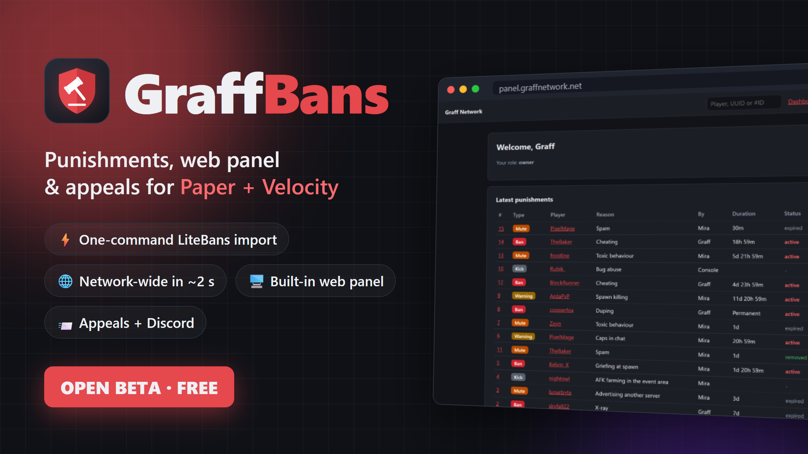</p>

# GraffBans

**Punishments, web panel and appeals for Paper servers and Velocity networks.**
Bans, mutes, warnings and kicks with punishment ladders, a built-in web panel, appeals and one-command
LiteBans import. One jar for Paper and Velocity.

> 🧪 **Open beta: free while it lasts.** GraffBans is free to use on any server during the beta.
> **GraffBans 1.0 will be a paid resource.** Beta releases keep working after that, but get no more updates.
>
> 🎁 **Beta testers who report a confirmed bug or a useful idea get 1.0 for free.** Report it in the
> [issues](https://github.com/g-raffie/GraffBans/issues).
>
> ⚠️ Beta software: **back up your database** before installing or updating.

Download: BuiltByBit (link coming). This repository holds the documentation
([Wiki](https://github.com/g-raffie/GraffBans/wiki)), the default configuration files ([`configs/`](configs))
and the [changelog](CHANGELOG.md).

<p align="center">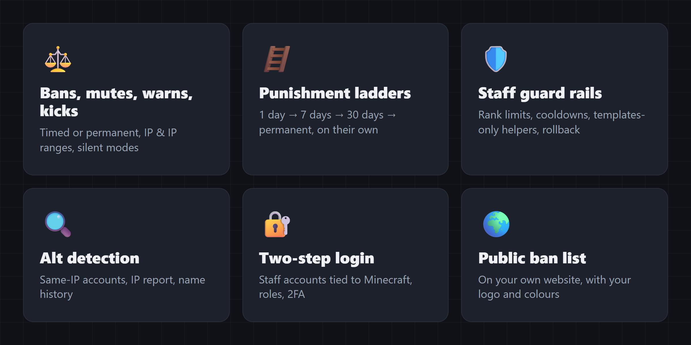</p>

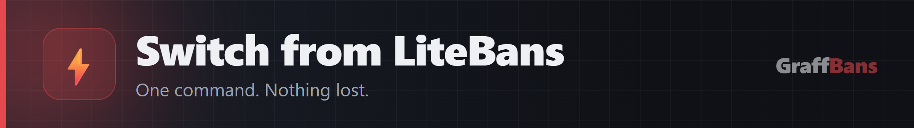

`/graffbans import litebans` brings over everything: bans, mutes, warnings, kicks, history, names, templates
and permission nodes, from H2, MySQL or MariaDB. Tested on a live network with **245,000 players: 12 seconds,
nothing lost**. Your staff keep the commands and flags they already know (`-s`, `-S`, `-d`, `-m`, `server:`,
punishment numbers...). Run it with `--dry-run` first to see what would be imported.
More: [Switching from LiteBans](https://github.com/g-raffie/GraffBans/wiki/Switching-from-LiteBans).

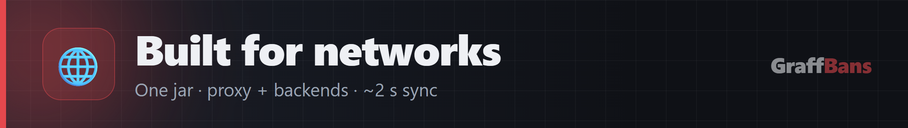

- **One jar** on the Velocity proxy and every backend, one shared MariaDB / MySQL database.
- Punishments reach every server in **about two seconds**: no Redis, no extra plugin, no duplicate announcements.
- Mutes that work with signed chat, server-scoped punishments, and an optional lobby that banned players can
  still join.

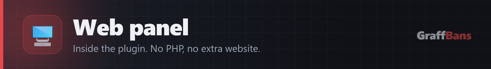

A web panel inside the plugin: **no PHP, no extra website**. Staff accounts are tied to Minecraft accounts, with
roles and two-step login. Everything done in the panel follows the same rules as in game: templates, rank
limits, cooldowns.

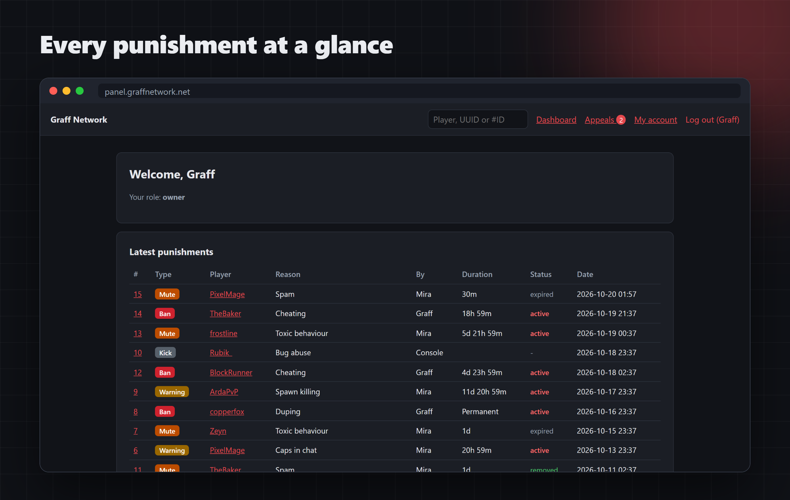
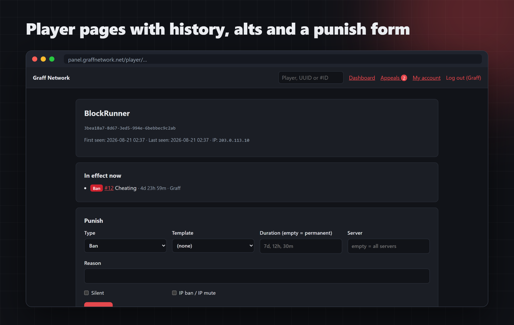


Every ban and mute carries a code that **only the punished player sees**, so nobody can appeal in someone
else's name. Players follow their appeal on a private page; staff answer, then accept, reduce or deny. New
appeals, replies and decisions can go to your Discord channel.

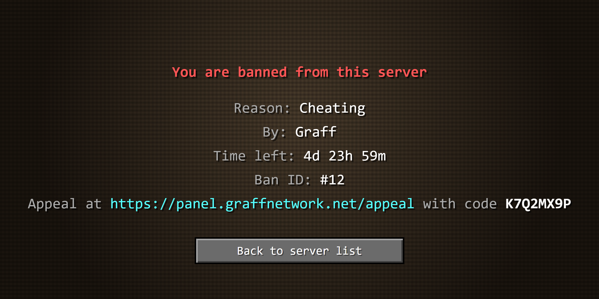
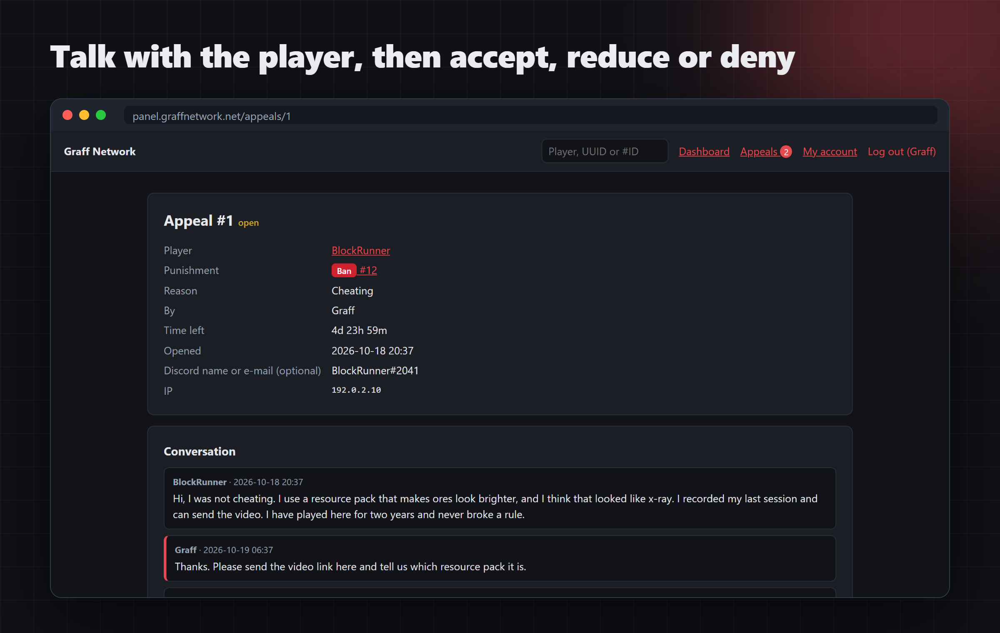
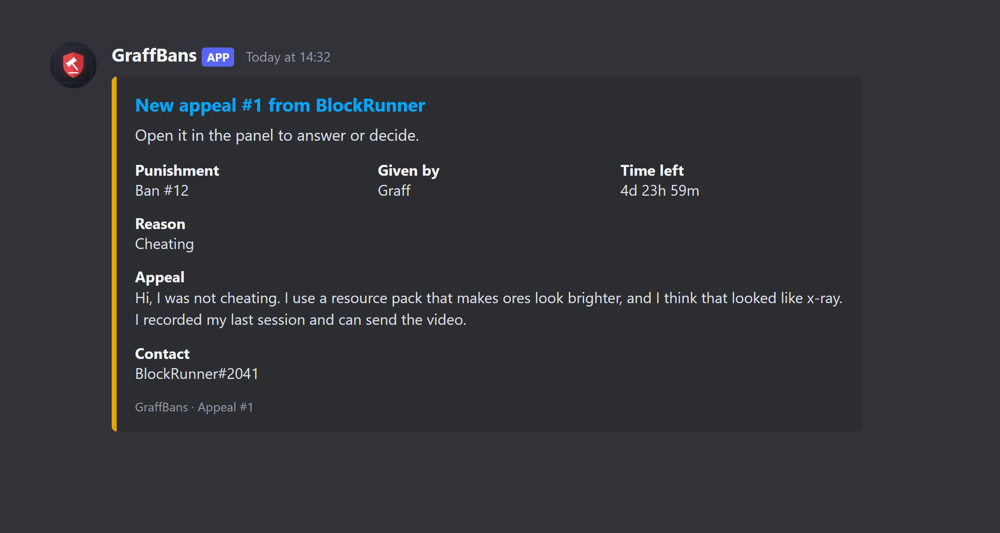
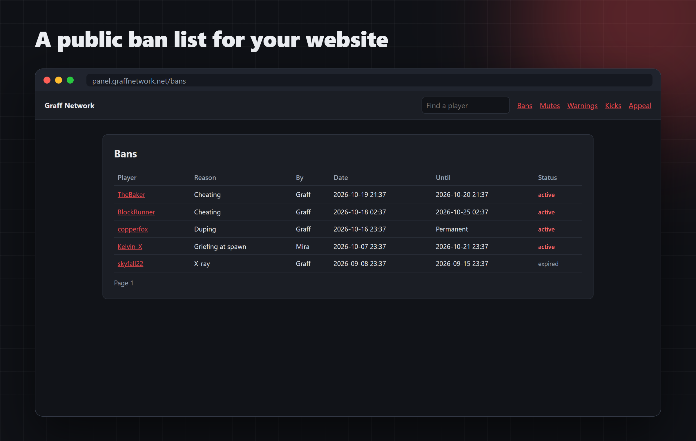

Turn on a **public ban list** and put it on your own website, with your name, logo and colours. IP addresses
and silent punishments are never shown there.

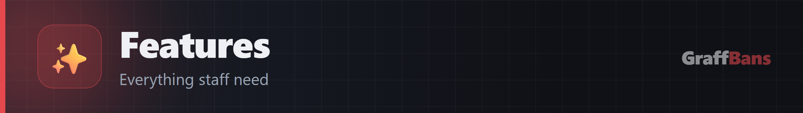

| Area | What you get |
|---|---|
| Punishments | Bans, mutes, warnings, kicks; permanent or timed; IP and IP-range (`1.2.3.*`) punishments; silent and console-only modes |
| Warnings | Expiring warnings, and automatic consequences at a number of warnings (e.g. a kick at 3, a 1-day ban from 4 on) |
| Editing | Change reason or duration in place, delete from history, replace a shorter punishment with a longer one |
| Targets | Player name, UUID (also for players who never joined) or punishment number (`#123`) |
| Templates | Ladders for bans, mutes, warnings and kicks (1 day, 7 days, 30 days, permanent...); per-step reason, screen, announcement and commands; shared ladders with weights; offences that expire |
| History | `/history`, `/staffhistory`, `/checkban`, `/banlist`, punishment lookup |
| Alts | `/dupeip`, `/ipreport`, IP history, `/namehistory`, exceptions for shared households |
| Staff | Rank limits and cooldowns, "templates only" for helpers, staff notices (banned join, muted chat, banned alt joined), full rollback |
| Server | `/lockdown` that survives restarts, per-server or network-wide |
| Chat | Muted players cannot dodge with `/msg`, `/r`, `/mail` and similar (configurable, blocks `/plugin:command` too) |
| Privacy | Player IPs hidden from players by default |
| Text | MiniMessage everywhere (hex colours, gradients, hover, click); English and Turkish included; reload without a restart |
| Database | Move from the built-in database to MariaDB / MySQL with one command when you grow into a network |
| Updates | Optional update check |

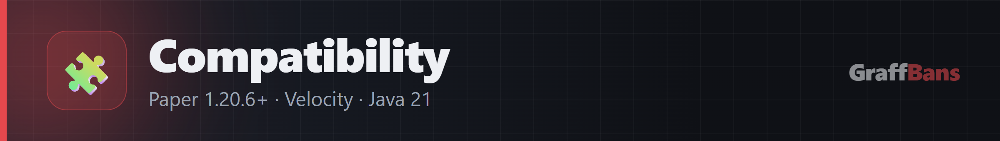

| | Supported |
|---|---|
| Server | Paper 1.20.6 and newer (tested on 1.20.6 and 26.x), Folia (experimental) |
| Proxy | Velocity 3.5+ and 4.x |
| Java | 21 or newer (Paper 26.x and Velocity 4.x need Java 25 themselves) |
| Database | H2 (built in, nothing to set up), MariaDB 10.6+, MySQL 8 |
| Permissions | Any permission plugin |
| Not supported | Spigot / CraftBukkit, BungeeCord / Waterfall, Fabric, PostgreSQL, Minecraft older than 1.20.6 |

| Your setup | Install on | Database |
|---|---|---|
| One Paper server | That server | H2 (default) |
| Velocity network | The proxy **and** every backend | One shared MariaDB / MySQL |


1. Put the jar into `plugins/` (on a network: the proxy **and** every backend) and start once.
2. Set `server-name`, `language` (`en` / `tr`) and, on a network, the shared `database` in
   `plugins/GraffBans/config.yml`, then restart.
3. Coming from LiteBans? Remove LiteBans, then run `/graffbans import litebans --dry-run` and
   `/graffbans import litebans`.

A few commands to try:

```
/ban Steve 7d Griefing          /tempmute Alex 30m Spam        /warn Sam Caps lock
/ban Steve hacking              # uses the "hacking" ladder from templates.yml
/history Steve                  /dupeip Steve                  /lockdown Maintenance
```

Everything else, including the web panel and appeals, is explained in the [wiki](https://github.com/g-raffie/GraffBans/wiki).

---

## The beta

The beta ends with 1.0 when all of this is true:
- at least 5 servers have used it for 2 weeks or more, at least one of them a Velocity network;
- no open issue labelled `critical`;
- at least 3 real moves from LiteBans went through without problems;
- a week without a new critical bug after the last beta release.

Updates: GraffBans tells the console (and staff with `graffbans.notify.update`) when a newer beta is out.
`update-check: false` in config.yml turns that off.

Found a security problem? Report it privately, see [SECURITY.md](SECURITY.md).

---

## Documentation

| Page | |
|---|---|
| [Installation](https://github.com/g-raffie/GraffBans/wiki/Installation) | Single server and network setup |
| [Configuration](https://github.com/g-raffie/GraffBans/wiki/Configuration) | Every `config.yml` section explained, including automatic actions on warnings |
| [Commands](https://github.com/g-raffie/GraffBans/wiki/Commands) | All commands |
| [Command Syntax](https://github.com/g-raffie/GraffBans/wiki/Command-Syntax) | Durations, flags, targets, punishment numbers |
| [Permissions](https://github.com/g-raffie/GraffBans/wiki/Permissions) | All permission nodes |
| [Templates](https://github.com/g-raffie/GraffBans/wiki/Templates) | Punishment ladders |
| [Networks](https://github.com/g-raffie/GraffBans/wiki/Networks) | Velocity, server scopes, sync |
| [Staff Limits](https://github.com/g-raffie/GraffBans/wiki/Staff-Limits) | Rank limits and cooldowns |
| [Messages](https://github.com/g-raffie/GraffBans/wiki/Messages) | Editing messages, placeholders, hover and click |
| [Switching from LiteBans](https://github.com/g-raffie/GraffBans/wiki/Switching-from-LiteBans) | One-command import |
| [Web Panel](https://github.com/g-raffie/GraffBans/wiki/Web-Panel) | Setting up the panel, HTTPS, roles, two-step login |
| [Appeals](https://github.com/g-raffie/GraffBans/wiki/Appeals) | Appeals and Discord notices |
| [Troubleshooting](https://github.com/g-raffie/GraffBans/wiki/Troubleshooting) | Common problems |

Default files: [`config.yml`](configs/config.yml) · [`messages_en.yml`](configs/messages_en.yml) ·
[`messages_tr.yml`](configs/messages_tr.yml) · [`templates.yml`](configs/templates.yml)

<sub>Screenshots show the panel with example data. The ban screen and the Discord notice are recreated with
the exact texts GraffBans shows.</sub>

---

© graffie. All rights reserved. The beta is free to use under the [GraffBans Beta License](LICENSE.md).
